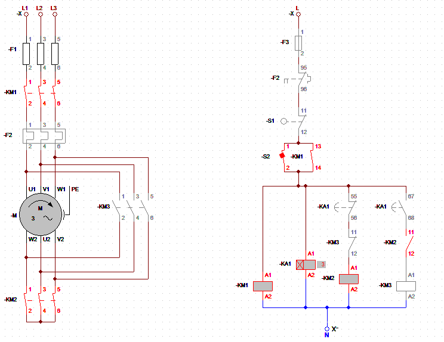
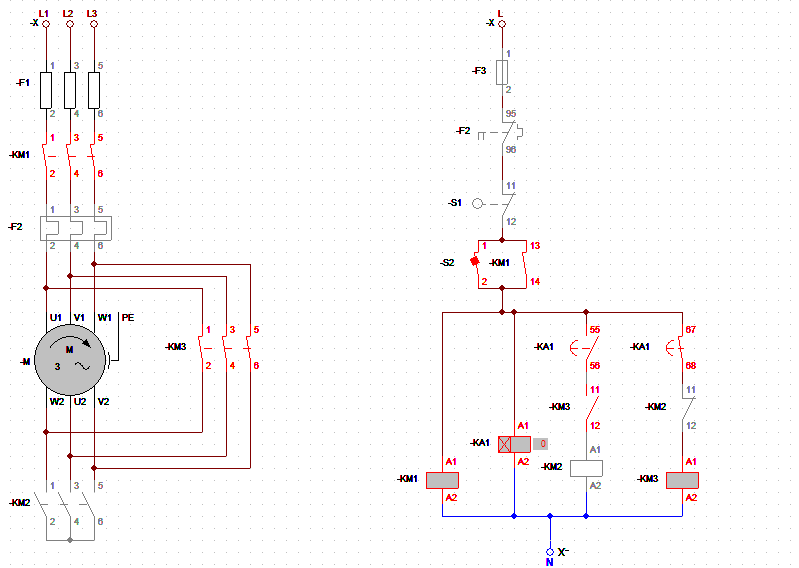

# 03 – Démarrage étoile-triangle d'un moteur asynchrone triphasé

Schéma de puissance et de commande d'un démarrage étoile-triangle automatique, avec temporisation et verrouillage électrique, conçu et simulé dans **CADe_SIMU**.

*Réalisé en novembre 2026 – Roméo Sylvain Ouédraogo*

## Objectif

Démarrer un moteur triphasé en limitant son courant de démarrage :
- démarrage en **étoile** (tension réduite sur chaque enroulement) ;
- passage **automatique** en **triangle** après une temporisation ;
- **verrouillage électrique** entre les contacteurs étoile et triangle ;
- **protection** contre les courts-circuits (fusibles) et contre les surcharges (relais thermique).

## Principe

En démarrage direct, un moteur absorbe 5 à 8 fois son courant nominal. Le démarrage étoile-triangle réduit cette pointe.

Un moteur à 6 bornes possède trois enroulements : U1-U2, V1-V2 et W1-W2.

| Couplage | Liaisons | Tension par enroulement (réseau 400 V) | Rôle |
| --- | --- | --- | --- |
| **Étoile (Y)** | U2, V2 et W2 reliés entre eux | 230 V | Démarrage : courant divisé par 3 |
| **Triangle (Δ)** | U1-W2, V1-U2, W1-V2 | 400 V | Marche normale : pleine puissance |

**Condition** : le moteur doit être prévu pour fonctionner en triangle sur le réseau (plaque 400/690 V sur un réseau 400 V).

**Limite** : le couple de démarrage est lui aussi divisé par 3. Ce démarrage convient donc aux machines qui démarrent à vide ou à faible charge.

## Outils

- CADe_SIMU (conception et simulation de schémas électriques)
- Windows 11 en machine virtuelle sous Ubuntu

## Composants

| Repère | Composant | Rôle |
| --- | --- | --- |
| F1 | Fusibles tripolaires | Protection du circuit de puissance contre les courts-circuits |
| KM1 | Contacteur de ligne | Alimente le moteur (U1, V1, W1) pendant toute la marche |
| KM2 | Contacteur étoile | Relie U2, V2 et W2 entre eux |
| KM3 | Contacteur triangle | Relie U1-W2, V1-U2 et W1-V2 |
| F2 | Relais thermique | Protection du moteur contre les surcharges |
| KA1 | Relais temporisé au travail (5 s) | Commande le passage de l'étoile au triangle |
| M | Moteur asynchrone triphasé à 6 bornes | Récepteur |
| F3 | Fusible | Protection du circuit de commande |
| S1 | Bouton-poussoir NF | Arrêt |
| S2 | Bouton-poussoir NO | Marche |

## Fonctionnement

**Circuit de commande** (L → N) : F3 → contact F2 (95-96, NF) → S1 (NF) → S2 (NO) en parallèle avec KM1 (13-14), puis quatre branches en parallèle :

| Branche | Contacts en série | Bobine |
| --- | --- | --- |
| Ligne | – | KM1 |
| Temporisation | – | KA1 |
| Étoile | KA1 temporisé NF (55-56) → KM3 NF | KM2 |
| Triangle | KA1 temporisé NO (67-68) → KM2 NF | KM3 |

**Séquence**
1. **Appui sur S2** : KM1, KA1 et KM2 s'activent. Le moteur démarre en **étoile**.
2. **Après 5 secondes** : le contact 55-56 de KA1 s'ouvre et coupe KM2 ; le contact 67-68 se ferme et alimente KM3. Le moteur passe en **triangle**, sans s'arrêter.
3. **Appui sur S1** : toutes les bobines sont coupées, le moteur s'arrête.

**Verrouillage électrique** : la branche étoile passe par un contact NF de KM3, et la branche triangle par un contact NF de KM2. Les deux contacteurs ne peuvent donc jamais être fermés en même temps, ce qui provoquerait un court-circuit entre phases.

## Tests réalisés en simulation

| Test | Résultat attendu | Résultat |
| --- | --- | --- |
| Appui sur S2 | KM1 + KM2 : le moteur démarre en étoile | ✅ |
| Fin de la temporisation (5 s) | KM2 s'ouvre, KM3 se ferme : passage en triangle sans arrêt | ✅ |
| Pendant toute la séquence | KM2 et KM3 ne sont jamais fermés ensemble | ✅ |
| Appui sur S1 | Le moteur s'arrête et ne redémarre pas seul | ✅ |
| Déclenchement de F2 | Le moteur s'arrête | ☐ |

## Captures

| Phase étoile | Phase triangle |
| --- | --- |
|  |  |

## Ce que j'ai appris

- **Pourquoi l'étoile-triangle** : réduire la pointe de courant au démarrage, au prix d'un couple de démarrage plus faible.
- **Les types de temporisation** : un relais temporisé *au travail* fait basculer ses contacts après un délai à la mise sous tension. Un relais temporisé *au repos* (ou à la déconnexion) garde ses contacts basculés après la coupure, ce qui permettrait ici de redémarrer directement en triangle. Un interrupteur horaire, lui, se déclenche à une heure de la journée : ce n'est pas un temporisateur.
- **Les contacts temporisés** (55-56, 67-68) doivent être du même type que la bobine qui les commande. Un contact ordinaire bascule immédiatement.
- **Le couplage triangle normalisé** : U1-W2, V1-U2, W1-V2, comme les barrettes d'une plaque à bornes.
- **Le point étoile doit réunir les trois enroulements** : si une seule des trois liaisons manque, le moteur ne démarre pas, même si tous les fils sont sous tension.
- **Tester séparément pour dépanner** : en câblant le moteur seul en étoile, j'ai pu vérifier que le composant fonctionnait et localiser la panne dans les liaisons du point étoile.

## Fichiers

- `schema.cad` : schéma CADe_SIMU
- `captures/` : captures de la simulation
